<a href="https://sasini-portfolio-topaz.vercel.app/">
  <picture>
    <source media="(prefers-color-scheme: dark)" srcset="./assets/header-dark.svg">
    
  </picture>
</a>

 

  

<picture>
  <source media="(prefers-color-scheme: dark)" srcset="./assets/divider-dark.svg">
  
</picture>

### ✦ About me

I'm **Sasini**, a full-stack developer and IT undergraduate at **SLIIT** from Sri Lanka. For two years at **ShemailoSoft** I built real client systems: online ordering for a restaurant in Finland, an e-commerce store with 1,400+ products, restaurant and retail POS systems, and booking platforms.

I love the space where logic meets design. Soft palettes, clear user journeys and mobile-first layouts, backed by clean APIs and solid databases.

- 🎓 &nbsp;BSc (Hons) in Information Technology, SLIIT
- 💼 &nbsp;Full-Stack Developer, ShemailoSoft (Pvt) Ltd
- 🌸 &nbsp;Open to internships, junior developer and UI/UX roles
- 📍 &nbsp;Kaduwela, Sri Lanka

<picture>
  <source media="(prefers-color-scheme: dark)" srcset="./assets/divider-dark.svg">
  
</picture>

### ✦ Selected work

<a href="https://www.power-pizza.fi/"><picture><source media="(prefers-color-scheme: dark)" srcset="./assets/card-powerpizza-dark.svg"></picture></a>
<a href="https://jksports.lk/"><picture><source media="(prefers-color-scheme: dark)" srcset="./assets/card-jksports-dark.svg"></picture></a>
<a href="https://sasini-portfolio-topaz.vercel.app/#work"><picture><source media="(prefers-color-scheme: dark)" srcset="./assets/card-uniconnect-dark.svg"></picture></a>
<a href="https://sasini-portfolio-topaz.vercel.app/#work"><picture><source media="(prefers-color-scheme: dark)" srcset="./assets/card-smartcampus-dark.svg"></picture></a>

<b>More projects</b>

 

| Project | What it is | Built with |
| :-- | :-- | :-- |
| **Air Ticket Management System** | Airline booking with flight scheduling, seat reservations and passenger records | React · TypeScript · PostgreSQL · Prisma |
| **Restaurant Management & POS** | Order processing, billing, inventory and sales tracking | React · Tailwind · Express · PostgreSQL |
| **Furniture Store POS** | Offline desktop point of sale with inventory, billing and invoices | Electron · React · PostgreSQL |
| **Personal Finance Tracker** | Android app for income, expenses and budgets | Kotlin · SQLite |
| **[Playwright Test Suite](https://github.com/SasiRanasinghe/IT3040_ITPM_Assignment1_IT23359888)** | End-to-end tests for a Singlish-to-Sinhala translator | Playwright · TypeScript |

<picture>
  <source media="(prefers-color-scheme: dark)" srcset="./assets/divider-dark.svg">
  
</picture>

### ✦ Tools I work with

<picture>
  <source media="(prefers-color-scheme: dark)" srcset="https://skillicons.dev/icons?i=react,nextjs,ts,js,tailwind,html,css,nodejs,express,spring,java,postgres,mongodb,mysql,prisma,electron,kotlin,docker,git,figma&perline=10&theme=dark">
  
</picture>

<picture>
  <source media="(prefers-color-scheme: dark)" srcset="./assets/divider-dark.svg">
  
</picture>

### ✦ My coding garden

<picture>
  <source media="(prefers-color-scheme: dark)" srcset="https://raw.githubusercontent.com/SasiRanasinghe/SasiRanasinghe/output/snake-lavender-dark.svg">
  
</picture>

<picture>
  <source media="(prefers-color-scheme: dark)" srcset="./assets/footer-dark.svg">
  
</picture>
